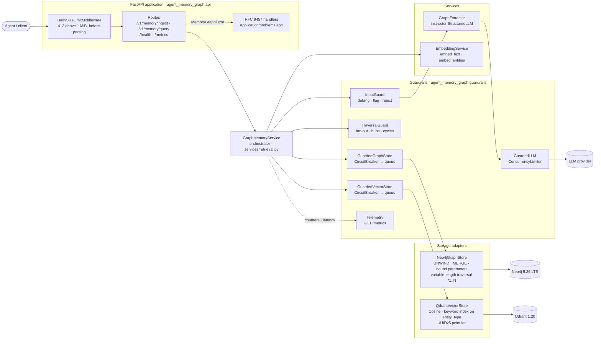
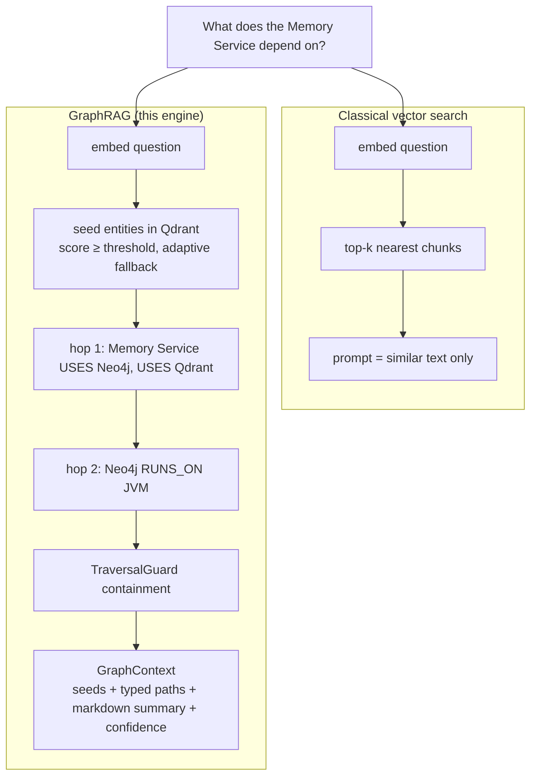
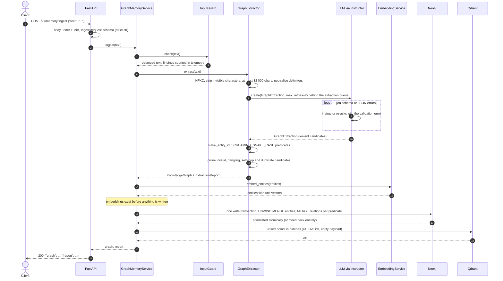
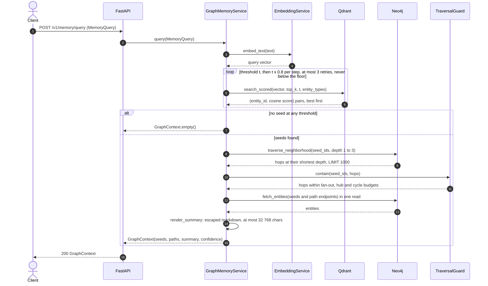
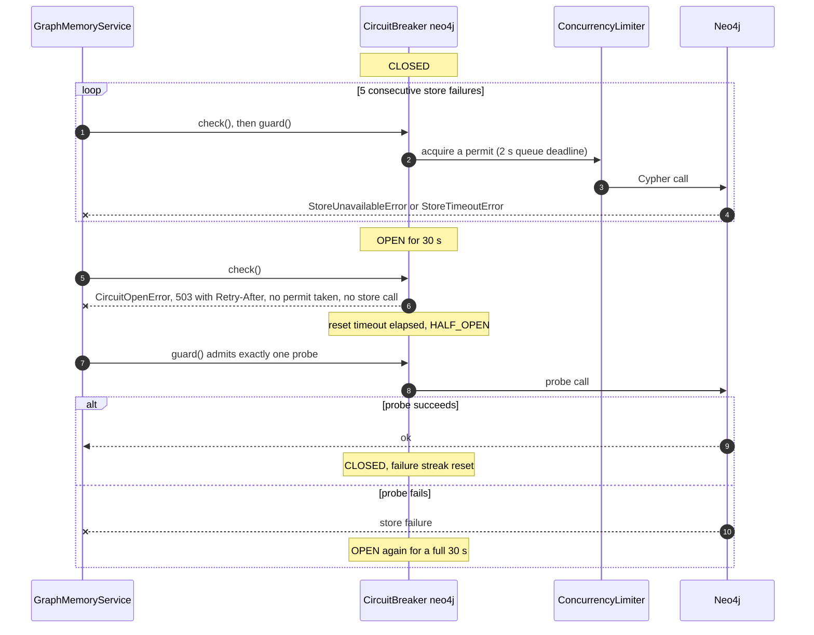

# agent-memory-graph

**Asynchronous GraphRAG long-term memory for AI agents.** Conversations go in; a typed
knowledge graph comes out. Entities and directed relations are stored in **Neo4j**, entity
embeddings in **Qdrant**. A question is answered by seeding from vector similarity and
then walking the graph, so the agent gets facts that are *related* to what it asked, not
just text that *looks like* it.

| | |
| --- | --- |
| Runtime | Python 3.12, FastAPI, Pydantic v2, `neo4j` 6 async driver, `qdrant-client` 1.20, `instructor` |
| API | `POST /v1/memory/ingest`, `POST /v1/memory/query`, `GET /health`, `GET /metrics`; every error is RFC 9457 `application/problem+json` |
| Safety | Prompt-injection screening, Cypher-injection allowlist, circuit breakers, bounded queues, traversal containment, body limit |
| Delivery | Digest-pinned, non-root (`10001:10001`), read-only container; hardened Compose stack; SHA-pinned CI with Trivy |
| Quality | `mypy --strict`, strict ruff, 100 % line + branch coverage on every layer, Hypothesis fuzzing, `python -X dev` e2e harness |

## Contents

- [Quickstart](#quickstart)
- [Architecture](#architecture)
- [Protocol lifecycle](#protocol-lifecycle)
- [API reference](#api-reference)
- [RFC 9457 error taxonomy](#rfc-9457-error-taxonomy)
- [Threat model (STRIDE)](#threat-model-stride)
- [Domain model](#domain-model)
- [Guardrails](#guardrails)
- [Configuration](#configuration)
- [Operations](#operations)
- [Verification and quality gates](#verification-and-quality-gates)
- [Repository layout](#repository-layout)
- [Contributing](#contributing)

## Quickstart

### Docker Compose (recommended)

```bash
export AMG_NEO4J_PASSWORD="$(openssl rand -base64 24)"
# Optional: the extraction model, in instructor's "provider/model" form.
export AMG_LLM_MODEL=anthropic/claude-opus-5-5 ANTHROPIC_API_KEY=sk-ant-...

docker compose up -d --wait            # builds the image, waits for all healthchecks
curl -s http://127.0.0.1:8000/health
# {"status":"ok","checks":{"graph_store":"ok","vector_store":"ok"}}
```

Only the API is published, and only on `127.0.0.1:8000`. Neo4j and Qdrant run on an
internal network with no host ports. Without `AMG_LLM_MODEL` the stack still boots and
answers queries, but ingestion returns `502 AMG_EXTRACTION_FAILED`.

### Local Python

```bash
direnv allow                           # every cache, the venv and temp files go under ./.cache/
uv sync --extra anthropic              # runtime + dev dependencies + the Anthropic SDK

# Stores for development, bound to loopback only (same pinned images as the stack).
docker run -d --name amg-neo4j -p 127.0.0.1:7687:7687 \
  -e NEO4J_AUTH="neo4j/$AMG_NEO4J_PASSWORD" \
  neo4j:5.26.27-community@sha256:937fbd163e302a5751dd329b719c1b05e2a4293af223d61b1aa17e3dea087709
docker run -d --name amg-qdrant -p 127.0.0.1:6333:6333 \
  qdrant/qdrant:v1.20.0@sha256:9bfc89f9914fc14876a88c05270685921a55b8877b254a98bcc1cc2f0a424cd2

export AMG_NEO4J_PASSWORD AMG_LLM_MODEL=anthropic/claude-opus-5-5 ANTHROPIC_API_KEY=sk-ant-...
python -m agent_memory_graph            # http://127.0.0.1:8000 (see --help)
```

### Remember something, then ask about it

```bash
curl -sS http://127.0.0.1:8000/v1/memory/ingest \
  -H 'content-type: application/json' \
  -d '{"text": "User: The Memory Service uses Neo4j for the graph and Qdrant for vectors.\nAssistant: And Neo4j runs on the JVM, right?\nUser: Yes. Ada Lovelace maintains the Memory Service."}'
```

```json
{
  "graph": {
    "entities": [
      {"id": "tool-memory-service", "name": "Memory Service", "entity_type": "TOOL",
       "description": "", "attributes": {}, "embedding": null},
      {"id": "tool-neo4j", "name": "Neo4j", "entity_type": "TOOL", "...": "..."}
    ],
    "relations": [
      {"source_id": "tool-memory-service", "predicate": "USES", "target_id": "tool-neo4j",
       "weight": 1.0, "properties": {}}
    ]
  },
  "report": {"entities": 5, "relations": 4, "merged_entities": 0, "invalid_entities": 0,
             "dangling_relations": 0, "invalid_predicates": 0, "self_loops": 0,
             "duplicate_relations": 0, "dangling_names": []}
}
```

```bash
curl -sS http://127.0.0.1:8000/v1/memory/query \
  -H 'content-type: application/json' \
  -d '{"text": "What does the Memory Service depend on?", "top_k": 3, "traversal_depth": 2}'
```

```json
{
  "seed_entities": [{"id": "tool-memory-service", "name": "Memory Service", "...": "..."}],
  "paths": [
    {"source_id": "tool-memory-service", "predicate": "USES", "target_id": "tool-neo4j", "weight": 1.0, "depth": 1},
    {"source_id": "tool-memory-service", "predicate": "USES", "target_id": "tool-qdrant", "weight": 1.0, "depth": 1},
    {"source_id": "tool-neo4j", "predicate": "RUNS_ON", "target_id": "tool-jvm", "weight": 1.0, "depth": 2}
  ],
  "summary": "## Relevant memories\n\n- **Memory Service** (tool)\n\n## Relationships\n\n- **Memory Service** USES **Neo4j** (weight 1.00, depth 1)\n- **Memory Service** USES **Qdrant** (weight 1.00, depth 1)\n- **Neo4j** RUNS_ON **JVM** (weight 1.00, depth 2)",
  "confidence": 0.71
}
```

The `summary` is ready to drop into a prompt. The JVM fact sits two hops from anything
the question mentions, which is exactly what plain vector search misses (see
[GraphRAG vs. classical vector search](#graphrag-vs-classical-vector-search)).

```bash
curl -s http://127.0.0.1:8000/metrics     # counters, latencies, queue occupancy, circuit states
```

## Architecture

### System topology



Layering is strict and enforced by imports. `domain/` is pure: no I/O and no driver
imports. `services/` depends on the domain and on narrow ports (`StructuredLLM`,
`EmbeddingService`, `GraphStore`, `VectorStore`). `adapters/` are the only modules that
talk to a database. `guardrails/` wraps the ports as decorators. `api/` and `server.py`
are the composition root.

### GraphRAG vs. classical vector search



Vector search returns things that look like the question. GraphRAG uses similarity
only to find *entry points*, then follows typed, directed, weighted relations for up to
`traversal_depth` hops (1 to 3, default 2). Each relation is returned once, at the shortest
depth it was reached, so the context carries structure (who uses what, what runs on what)
that no single similar chunk contains.

## Protocol lifecycle

### Ingestion



Neo4j and Qdrant cannot share a transaction, so the graph is written first: a vector
never points at a node that doesn't exist. If the upsert then fails, the graph is
complete but those entities aren't seedable yet. Every step is idempotent (deterministic
ids, `MERGE`, upserts), so retrying the same ingest converges.

### Retrieval



### Circuit breaker trip and recovery



Only failures of the *store* count: unavailable, timed out, or vector-search timeout.
Rejections of the *request* (integrity errors, invalid input) prove the store is
answering and reset the streak. A queue-deadline rejection signals local overload and
never trips a breaker. A call that started before the trip and fails afterwards doesn't
extend the open window.

## API reference

All bodies are JSON. Unknown fields are rejected (`extra="forbid"`), scalars are strict
(`"5"` is not an int, `true` is not a number), and bodies over 1 MiB get `413` before
they are parsed.

| Method & path | Request | Success | Errors |
| ------------- | ------- | ------- | ------ |
| `POST /v1/memory/ingest` | `{"text": str}`, 1 to 128 000 raw chars (32 000 after cleaning) | `200 {"graph": KnowledgeGraph, "report": ExtractionReport}` | 422, 502, 503, 504, 500 |
| `POST /v1/memory/query` | `MemoryQuery` | `200 GraphContext` (`GraphContext.empty()` when nothing matches) | 422, 503, 504, 500 |
| `GET /health` | | `200 {"status": "ok", "checks": {"graph_store": "ok", "vector_store": "ok"}}` | `503`, same shape, `"status": "degraded"` |
| `GET /metrics` | | `200` telemetry snapshot | |
| `GET /openapi.json` | | OpenAPI 3.1 document, problem responses included | |

**`MemoryQuery`**

| Field | Type | Default | Constraint |
| ----- | ---- | ------- | ---------- |
| `text` | string | required | 1 to 4096 printable chars after NFKC and invisible-character stripping |
| `top_k` | int | `5` | 1 to 20 |
| `score_threshold` | float | `0.0` | 0 to 1 (cosine); relaxed by the adaptive fallback when nothing matches |
| `traversal_depth` | int | `2` | 1 to 3 hops |
| `entity_types` | list of `EntityType` or `null` | `null` (all) | non-empty, deduplicated, canonical order |

**`GraphContext`**: `seed_entities` (best match first), `paths` (`GraphHop`:
`source_id`, `predicate`, `target_id`, `weight`, `depth`), `summary` (markdown, names
escaped, at most 32 768 chars), and `confidence` (the best seed's cosine similarity in
[0, 1]).

**`GET /metrics`** returns `uptime_seconds`; `counters` (`ingest_requests`,
`ingest_failures`, `query_requests`, `query_failures`, `entities_indexed`,
`relations_indexed`, `candidates_pruned`, `suspicious_inputs`, `query_fallbacks`,
`fallback_hits`, `empty_contexts`, `traversal_hops_pruned`); `latency.ingest` and
`latency.query` (count, sum, min, max, mean, p50, p95, p99, cumulative buckets);
`limiters` (capacity, in use, available, waiting, acquired, rejected); and `circuits`
(state, consecutive failures, times opened, rejected).

## RFC 9457 error taxonomy

Every error is `application/problem+json`. Members:

| Member | Meaning |
| ------ | ------- |
| `type` | Stable URN identifying the problem class; one per `code` |
| `title` | Fixed human summary for the `type` (never varies between occurrences) |
| `status` | HTTP status, fixed per `type` |
| `detail` | Occurrence-specific explanation, never containing rejected values or server messages |
| `instance` | The request path, unless the error names a more specific occurrence URI |
| `code` | Extension: machine-readable `AMG_*` code |
| `context` | Extension: JSON object of structured, non-sensitive facts (below) |

`MemoryProblemDetails` refuses to construct a body whose `type`, `title` and `status`
disagree with the taxonomy, so a code can never be reported with conflicting semantics.

| `code` | `type` | `title` | Status | Raised by | `context` members |
| ------ | ------ | ------- | ------ | --------- | ----------------- |
| `AMG_INVALID_INPUT` | `urn:agent-memory-graph:problem:invalid-input` | The request input is invalid | 422 | Request validation, oversized conversation text, `InputGuard` in reject mode | `errors`: `[{"loc", "msg", "type"}]`, without the rejected input |
| `AMG_ENTITY_INTEGRITY` | `urn:agent-memory-graph:problem:entity-integrity` | Knowledge graph integrity violated | 422 | Neo4j uniqueness constraint, relation count mismatch during ingest | `dangling_ids`, `duplicate_ids` |
| `AMG_TRAVERSAL_DEPTH_EXCEEDED` | `urn:agent-memory-graph:problem:traversal-depth-exceeded` | Graph traversal depth exceeds the allowed maximum | 422 | Programmatic traversal deeper than 3 (the HTTP API rejects it earlier as invalid input) | `requested_depth`, `max_depth` |
| `AMG_INTERNAL_ERROR` | `urn:agent-memory-graph:problem:internal-error` | Internal memory graph error | 500 | Unexpected exceptions (logged, never returned), rejected store credentials, stored data violating the contract | `{}`, or `store`, `operation`, plus `neo4j_code` / `http_status` / `collection` |
| `AMG_EXTRACTION_FAILED` | `urn:agent-memory-graph:problem:extraction-failed` | The language model did not return a usable extraction | 502 | instructor retries exhausted, provider client error, no `AMG_LLM_MODEL` | `reason`, `attempts` |
| `AMG_STORE_UNAVAILABLE` | `urn:agent-memory-graph:problem:store-unavailable` | A backing store is unavailable | 503 | Unreachable store, expired session, transient failure, HTTP 502/503, **open circuit** | `store`, `retry_after_seconds` (open circuit; also sent as the `Retry-After` header) |
| `AMG_STORE_TIMEOUT` | `urn:agent-memory-graph:problem:store-timeout` | A backing store operation exceeded its deadline | 504 | Client deadline, Neo4j transaction timeout, **queue deadline** (`operation: "queue"`) | `store`, `operation`, `timeout_seconds` |
| `AMG_VECTOR_SEARCH_TIMEOUT` | `urn:agent-memory-graph:problem:vector-search-timeout` | Vector search exceeded its deadline | 504 | Qdrant seed search past its deadline (client, httpx or HTTP 504) | `timeout_seconds`, `collection` |
| `AMG_EXTRACTION_TIMEOUT` | `urn:agent-memory-graph:problem:extraction-timeout` | Knowledge extraction exceeded its deadline | 504 | Extraction deadline (60 s) or extraction queue deadline | `timeout_seconds` |

Framework-level errors have no further semantics and use `type: "about:blank"`
(RFC 9457 §4.2.1) with the HTTP reason phrase as `title`: `404 Not Found`,
`405 Method Not Allowed` (the `Allow` header is kept), and `413 Content Too Large`.

```bash
curl -sS http://127.0.0.1:8000/v1/memory/query -H 'content-type: application/json' \
  -d '{"text": "x", "traversal_depth": 9}'
```

```json
{
  "type": "urn:agent-memory-graph:problem:invalid-input",
  "title": "The request input is invalid",
  "status": 422,
  "detail": "The request does not match the API contract.",
  "instance": "/v1/memory/query",
  "code": "AMG_INVALID_INPUT",
  "context": {"errors": [{"loc": ["body", "traversal_depth"],
                          "msg": "Input should be less than or equal to 3",
                          "type": "less_than_equal"}]}
}
```

## Threat model (STRIDE)

Assets: the memory graph (integrity), the agent's prompts that consume `GraphContext`
(integrity against injection), store credentials (confidentiality), and service
availability. Trust boundaries: the HTTP client (untrusted), conversation text and LLM
output (untrusted data), and the stores (trusted, but treated as fallible).

| STRIDE | Threat | Defence | Where | Proven by |
| ------ | ------ | ------- | ----- | --------- |
| **S**poofing | Conversation text forges an operator turn (`System:`, `<\|im_start\|>`, `[INST]`, `<<SYS>>`, a fake `</conversation>`) to impersonate the system or developer | `InputGuard` defangs structural markers in place (brackets become parentheses, role headers become `[System]:`) and flags overrides. The extraction prompt wraps the text in neutralised delimiters and declares it "data, not instructions" | `guardrails/graph_guard.py`, `services/extractor.py` | `test_guardrails.py`, fuzzed fixed point in `test_fuzzing.py` |
| **T**ampering | Trojan Source / homoglyph text (bidi overrides, zero-width joiners, fullwidth letters) smuggles look-alike names or hides instructions | NFKC normalisation and removal of every Unicode `C*` code point in names, descriptions, queries and screened text. Ids are derived, never accepted from the model | `domain/_base.py`, `domain/models.py` | `test_schemas.py` (sanitisation), `test_fuzzing.py` (ids) |
| **T**ampering | An LLM or forged payload writes dangling, duplicate or malformed graph data | Lenient candidate schema, then strict domain validation. Dangling, self-loop and duplicate relations are pruned and counted. `KnowledgeGraph` enforces referential integrity, and Neo4j writes are one transaction | `services/extractor.py`, `domain/models.py`, `adapters/neo4j.py` | `test_extractor.py`, `test_fuzzing.py` |
| **R**epudiation | Abuse or degradation goes unnoticed | `Telemetry` counts every ingest and query (requests, failures, suspicious inputs, pruned candidates and hops, fallbacks, empty contexts) with latency distributions and live breaker and queue state at `GET /metrics`. 5xx problems are logged with the exception; injection findings are logged by kind | `guardrails/telemetry.py`, `api/problems.py` | `test_guardrails.py`, `test_api.py`, e2e |
| **I**nformation disclosure | Error bodies echo secrets, payloads, server messages or stack traces | RFC 9457 bodies are built from the taxonomy. Validation errors list only `loc`, `msg` and `type` (never `input` or `ctx`). Unexpected exceptions become a generic 500. Driver messages are reduced to codes. Secrets are `SecretStr`, and a Qdrant key is refused over plaintext | `api/problems.py`, `domain/errors.py`, `config.py`, adapters | `test_api.py` (`sk-secret-value`, `hunter2` never returned), `test_config.py` |
| **D**enial of service | Graph fan-out bombs: hubs, dense cycles, star topologies | Traversal bounded to 1 to 3 hops and `LIMIT 1000` with a server-side transaction timeout. `TraversalGuard` caps 500 edges per seed, 100 out-edges per node and 100 cycle edges, and drops orphans | `adapters/neo4j.py`, `guardrails/graph_guard.py` | `test_guardrails.py`, fuzzed on 1 500-leaf stars and 20 000-hop chains |
| **D**enial of service | Request floods and slow dependencies exhaust workers or pools | Bounded queues per store and for extraction with a 2 s deadline (504 instead of pile-ups). Circuit breakers fail fast with `Retry-After`. Every store call has a client and server deadline | `guardrails/limiter.py`, `guardrails/stores.py` | `test_guardrails.py` (saturation, trip, half-open) |
| **D**enial of service | Oversized or endless bodies, ReDoS | 1 MiB body limit (declared or streamed). Raw and cleaned text ceilings. Input-guard regexes use bounded single-class repetition and are linear on adversarial input | `api/middleware.py`, `guardrails/graph_guard.py` | `test_api.py` (413), `test_guardrails.py` (linear-time scan) |
| **E**levation of privilege | Cypher injection through predicates or traversal depth, which Cypher cannot parameterise | Every value is a bound parameter. Relationship types are re-checked against the `[A-Z0-9_]` allowlist and backtick-quoted right before splicing, even for `model_construct` objects. Depth is spliced only as a validated int in 1 to 3 | `adapters/neo4j.py`, `domain/models.py` | `test_adapters.py` (`DETACH DELETE` payloads rejected before any session) |
| **E**levation of privilege | Container escape or lateral movement after compromise | Non-root `10001:10001`, read-only root filesystem with a `noexec` tmpfs, `cap_drop: [ALL]`, `no-new-privileges`. No pip, apt, dpkg or setuid binaries in the image. Stores on an internal network without published ports | `Dockerfile`, `docker-compose.yml` | `scripts/container_policy.py`, `smoke-docker.sh` (in-container checks) |
| **E**levation of privilege | Supply-chain tampering in CI or images | Images pinned by digest. Actions pinned by full commit SHA. Read-only workflow token, no persisted checkout credentials, no `pull_request_target`. Trivy fails closed on fixable CRITICAL/HIGH | `.github/workflows/ci.yml` | `scripts/audit-workflows.py`, `test_workflow_policy.py` |

Residual risks:

- `InputGuard` flags, but does not remove, natural-language overrides such as "ignore
  previous instructions". The downstream prompt must still treat `GraphContext` as data.
- Traversal fan-out is bounded after the database query, so a very dense graph costs
  Neo4j work up to the query `LIMIT` and timeout.
- The default embedder is lexical, not semantic (see [Operations](#operations)).

## Domain model

`agent_memory_graph.domain` is immutable all the way down: `frozen=True`,
`extra="forbid"`, tuples and read-only mappings.

- **`EntityType`**: `PERSON`, `ORGANIZATION`, `TOOL`, `CONCEPT`, `LOCATION`, `EVENT`,
  `MISC`.
- **`Entity`**: `id` (lowercase slug such as `tool-neo4j`, or a canonical UUID), `name`
  (single line, NFKC, at most 256 chars), `entity_type`, `description` (at most 4096
  chars, line structure kept), `attributes` (read-only JSON), and an optional
  `embedding`. `make_entity_id(name, type)` is deterministic, case- and
  padding-insensitive, and namespaced by type, falling back to UUIDv5 for names without
  an ASCII slug.
- **`Relation`**: `source_id`, `predicate` (`dependsOn` and `depends on` both become
  `DEPENDS_ON`), `target_id`, `weight` in [0, 1], and `properties`.
- **`KnowledgeGraph`** rejects duplicate ids, dangling endpoints and duplicate triplets.
- **`MemoryQuery`**, **`GraphHop`** and **`GraphContext`**: see the
  [API reference](#api-reference).

## Guardrails

| Guard | Default | Behaviour |
| ----- | ------- | --------- |
| `ConcurrencyLimiter` | 32 per store, 4 for extraction, 2 s queue deadline | `AMG_STORE_TIMEOUT` (`operation: "queue"`) or `AMG_EXTRACTION_TIMEOUT` instead of unbounded waiting |
| `CircuitBreaker` | trips after 5 failures, resets after 30 s | Fail fast while open, then exactly one half-open probe; `CircuitOpenError` is a 503 with `Retry-After` |
| `InputGuard` | `flag` | Structural forgeries are defanged and overrides counted; `reject` refuses with 422 |
| `TraversalGuard` | 500 per seed, 100 per node, 100 cycle edges | Shallowest and strongest edges are kept; paths always stay anchored to a seed |
| `RetrievalPolicy` | factor 0.8, floor 0.1, 3 steps | Strictly decreasing threshold schedule, never below the floor |
| `BodySizeLimitMiddleware` | 1 MiB | 413 by `Content-Length`, or mid-stream when there is none |

## Configuration

Settings are read from `AMG_*` environment variables only; no `.env` file is ever loaded.
Empty values, which Compose passes for unset `${VAR:-}`, mean *unset* for optional
fields.

| Variable | Default | Notes |
| -------- | ------- | ----- |
| `AMG_NEO4J_URI` | `neo4j://localhost:7687` | `neo4j` or `bolt`, optionally `+s` / `+ssc`; credentials in the URI are rejected |
| `AMG_NEO4J_USER` | `neo4j` | |
| `AMG_NEO4J_PASSWORD` | **required** | secret |
| `AMG_NEO4J_DATABASE` | server home database | |
| `AMG_NEO4J_MAX_POOL_SIZE` | `50` | |
| `AMG_QDRANT_URL` | `http://localhost:6333` | `http` or `https` |
| `AMG_QDRANT_API_KEY` | unset | secret; requires `https` unless the host is loopback |
| `AMG_QDRANT_COLLECTION` | `amg_entities` | |
| `AMG_QDRANT_UPSERT_BATCH_SIZE` | `256` | |
| `AMG_EMBEDDING_DIM` | `384` | 1 to 8192; must match the embedder |
| `AMG_DEFAULT_TIMEOUT_SECONDS` | `10.0` | per store operation, client and server side |
| `AMG_LLM_MODEL` | unset | `provider/model` for `instructor.from_provider`, e.g. `anthropic/claude-opus-5-5` |
| `AMG_LLM_MAX_TOKENS` | `16000` | per extraction call |
| `AMG_MAX_CONCURRENT_EXTRACTIONS` | `4` | |
| `AMG_MAX_CONCURRENT_STORE_OPERATIONS` | `32` | per store |
| `AMG_QUEUE_TIMEOUT_SECONDS` | `2.0` | |
| `AMG_BREAKER_FAILURE_THRESHOLD` | `5` | |
| `AMG_BREAKER_RESET_SECONDS` | `30.0` | |
| `AMG_INPUT_GUARD_MODE` | `flag` | `flag` or `reject` |
| `AMG_RETRIEVAL_FALLBACK_STEPS` | `3` | `0` disables the fallback |
| `AMG_RETRIEVAL_FALLBACK_FLOOR` | `0.1` | |
| `AMG_HTTP_HOST` / `AMG_HTTP_PORT` | `127.0.0.1` / `8000` | launcher; the image binds `0.0.0.0` |
| `AMG_LOG_LEVEL` | `info` | launcher |
| `AMG_GRACEFUL_TIMEOUT_SECONDS` | `10` | drain time after SIGTERM |

Provider credentials use the provider's own variables, for example `ANTHROPIC_API_KEY`.

## Operations

- **Process:** `python -m agent_memory_graph [--host --port | --uds PATH] [--factory module:callable]`.
  - Settings are validated at startup; a bad configuration exits with code 3.
  - SIGTERM or SIGINT drains in-flight requests, the lifespan closes both connection
    pools, and the process exits **0**. Uvicorn re-raises the signal by default; the
    launcher turns a completed graceful shutdown into an explicit success.
- **Startup:** the lifespan connects both stores and creates the `Entity.id` uniqueness
  constraint and the Cosine collection with its `entity_type` index, idempotently. A
  failed start leaks no pool.
- **Health:** `GET /health` pings both stores concurrently through their breakers. It
  returns 200 when both answer and 503 `degraded` otherwise, and suits readiness probes.
  The image and Compose healthchecks use it.
- **Embeddings:** the default app uses `MockEmbeddingService`, deterministic signed
  feature hashing over word tokens, and logs a warning saying so. It is lexical:
  synonyms without shared words won't match. For production recall, pass a semantic
  `EmbeddingService` to `build_memory_service` with the same `AMG_EMBEDDING_DIM`.
- **Upgrades:**
  - Base images are pinned by tag *and* digest in `Dockerfile` and
    `docker-compose.yml`; bump both together.
  - Changing `ENTITY_NAMESPACE` or the id scheme would re-key every UUIDv5 id.
  - Changing `AMG_EMBEDDING_DIM` needs a new collection, because `ensure_collection`
    refuses a mismatched one.

### Container

| Property | Value |
| -------- | ----- |
| Base | `python:3.12.13-slim-trixie` by digest; builder uses `uv:0.11.7` by digest |
| User | `appuser` `10001:10001`; the venv is root-owned and immutable |
| Filesystem | `--read-only`; only `/tmp` (tmpfs, `noexec,nosuid,nodev`) is written; bytecode precompiled |
| Removed | pip, `apt`, `dpkg` and their state, setuid/setgid bits, docs |
| Entrypoint | `["python", "-m", "agent_memory_graph"]`, exec form, PID 1 receives SIGTERM |
| Health | exec-form Python `HEALTHCHECK` on `/health`; `STOPSIGNAL SIGTERM` |
| Labels | OCI (`licenses=MIT`, `source`, `version`, `revision`, ...) |
| Extras | provider SDKs opt-in: `--build-arg AMG_EXTRAS=anthropic` (Compose default) |

`scripts/smoke-docker.sh` checks the container in three modes:

- **`--offline`:** policy, hadolint and Compose config checks; no daemon needed.
- **Default:** adds an image build and in-container checks.
- **`--live`:** also boots the stack, probes `/health` and requires exit 0 after SIGTERM.

## Verification and quality gates

| Gate | Tool | Enforces |
| ---- | ---- | -------- |
| Lint and format | `ruff` (line length 100, broad strict rule set) | Annotations, docstrings, security (`S`), async, pathlib, ... |
| Types | `mypy --strict` + pydantic plugin | `src/`, `tests/`, `scripts/` |
| Tests | `pytest`, `pytest-asyncio`, `pytest-socket` | Inet sockets blocked; warnings are errors |
| Fuzzing | Hypothesis (`dev` 50 / `ci` 200 examples) | Defanging fixed point, id determinism, graph integrity, containment limits, fallback convergence |
| End to end | `python -X dev -m agent_memory_graph` over a Unix socket | Full HTTP scenario, no unawaited coroutines or `ResourceWarning`s, SIGTERM and SIGINT exit 0 |
| Coverage | `scripts/coverage-gate.sh` | 100 % on `domain/`; at least 95 % on adapters, config, services, api, guardrails and the entrypoint (all currently 100 %) |
| Security | `bandit` | `src/` |
| Containers | `scripts/container_policy.py`, `scripts/smoke-docker.sh` | Dockerfile, `.dockerignore`, Compose hardening |
| Workflows | `scripts/audit-workflows.py` | SHA pins, least privilege, runner pin, no script injection, gate wiring |
| Documentation | `tests/unit/test_docs.py` | Taxonomy, settings and routes match the code; Mermaid and markdown structure |
| Hygiene | `scripts/audit-attribution.sh`, `audit-hygiene.sh`, `audit-cache-leaks.sh` | Sole committer, Conventional Commits, no machine paths or secrets, no caches outside `./.cache/` |

```bash
ruff check . && ruff format --check . && mypy && bandit -c pyproject.toml -r src
HYPOTHESIS_PROFILE=ci pytest && scripts/coverage-gate.sh
scripts/smoke-docker.sh --offline && python scripts/audit-workflows.py
scripts/audit-attribution.sh HEAD && scripts/audit-hygiene.sh && scripts/audit-cache-leaks.sh
```

CI (`.github/workflows/ci.yml`, `ubuntu-24.04`, `contents: read`, SHA-pinned actions) runs
three jobs:

- **`attribution-audit`:** commit identity and messages, plus tracked-file hygiene.
- **`code-quality`:** every gate above with `HYPOTHESIS_PROFILE=ci`.
- **`container-security`:** a Buildx image, `smoke-docker.sh --live`, and Trivy, which
  fails closed on fixable CRITICAL/HIGH vulnerabilities and secrets.

## Repository layout

```text
src/agent_memory_graph/
  domain/        immutable schemas, retrieval contracts, RFC 9457 taxonomy (pure)
  adapters/      Neo4jGraphStore, QdrantVectorStore (the only database code)
  services/      GraphExtractor (instructor), EmbeddingService, GraphMemoryService
  guardrails/    limiters, circuit breakers, input/traversal guards, telemetry, guarded ports
  api/           FastAPI app, routes, problem handlers, body-size middleware
  config.py      AMG_* settings
  server.py      process entrypoint (python -m agent_memory_graph)
tests/
  unit/          unit, API, fuzzing, policy and documentation tests
  e2e/           uvicorn subprocess harness (python -X dev, Unix socket)
scripts/         audits, coverage gate, container and workflow policy, smoke tests
.githooks/       pre-commit, commit-msg and pre-push hooks with shared policy
Dockerfile, .dockerignore, docker-compose.yml, .github/workflows/ci.yml
```

## Contributing

This repository has a single committer: every commit is authored and committed as
`mikeZ98 <145975972+mikeZ98@users.noreply.github.com>` with a
[Conventional Commits](https://www.conventionalcommits.org/) subject and no
tool-generated trailers. The local hooks (`git config core.hooksPath .githooks`, done by
`direnv allow`) and CI reject anything else. Keep every cache under `./.cache/`.

Licensed under the [MIT License](LICENSE).
